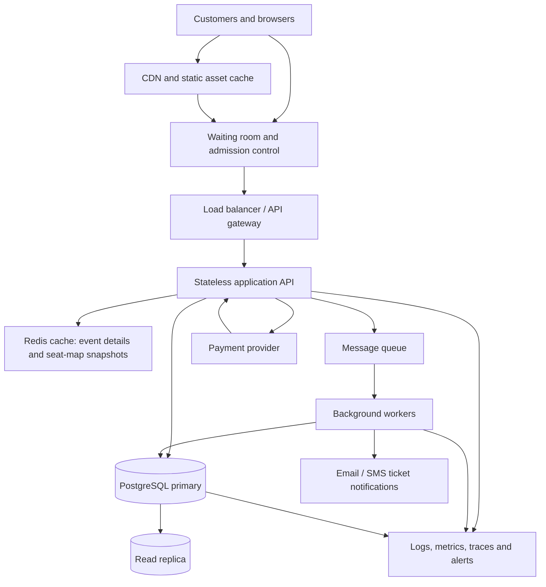

# TicketHub: Ticketing Website Design

**Repository:** `web-foundations-days`  
**Folder:** `day8/`  
**System:** TicketHub  
**Status:** Proposed design

## 1. Requirements

### 1.1 Functional requirements

1. Visitors can register, sign in, and manage their profiles.
2. Users can browse, search, filter, and view event details, including venue, date, ticket categories, prices, and availability.
3. Users can view a venue's seat map and see whether each seat is available, temporarily held, or sold.
4. An authenticated user can request a temporary hold on one or more available seats. A hold has a fixed expiry time (for example, five minutes).
5. Users can pay for an order using a supported payment provider. A successful, verified payment converts held seats into sold seats and produces tickets.
6. Users can view their orders and retrieve their purchased tickets, including a scannable ticket identifier.
7. Event administrators can create events, configure seats and prices, and monitor sales.
8. The system sends order and ticket confirmations and handles payment failures, cancellations, and expired holds.
9. The system supports a waiting room for high-demand sales and communicates the queue policy and estimated wait clearly.

### 1.2 Non-functional requirements

| Quality | Requirement |
|---|---|
| Speed | Event pages should usually load in under 2 seconds. Seat availability and hold requests should usually complete in under 500 ms at normal load, excluding payment-provider time. |
| Correctness | A physical seat must never be sold to more than one customer for the same event. Payment callbacks must be verified and processed idempotently. |
| Fairness | For a high-demand launch, use a published waiting-room policy, such as a randomized queue for everyone admitted during a short registration window. Enforce one active queue identity per account/session, rate limits, and bot checks. Do not let repeated refreshes improve queue position. |
| Availability | Target 99.9% monthly availability for browsing and account access. During a major sale, protect inventory and checkout even if non-essential features are degraded. |
| Scalability | Stateless web/API services should scale horizontally. Queueing and caching should absorb sudden read and arrival spikes. |
| Security | Use HTTPS, secure password hashing, authorization checks, payment-provider tokenization, input validation, and protection against common web attacks. Never store raw card details. |
| Privacy | Collect only necessary personal data, restrict staff access, and define retention and deletion rules. |
| Recoverability | Use automated database backups, point-in-time recovery, monitoring, and tested restore procedures. |
| Accessibility | Seat selection, checkout, and ticket retrieval should be usable with keyboard navigation and assistive technology. Provide a non-seat-map selection route. |

**Correctness takes priority over accepting every checkout request.** If the inventory database cannot safely confirm a seat, TicketHub must fail closed and ask the user to retry rather than risk selling the same seat twice.

## 2. Traffic and capacity estimates

### 2.1 Normal day

Given:
- 2,000,000 registered users.
- 50,000 daily visitors.
- 10 page views per visitor.
- 5,000 tickets sold per day.

Calculations (using 86,400 seconds per day):

| Metric | Calculation | Estimate |
|---|---:|---:|
| Daily page views | 50,000 × 10 | 500,000 |
| Average page views/second | 500,000 ÷ 86,400 | 5.8 |
| Average visitors/second | 50,000 ÷ 86,400 | 0.58 |
| Average tickets sold/second | 5,000 ÷ 86,400 | 0.058 |

The 5.8 page views/second is an average, not a peak. Actual traffic will be higher around popular events and lower overnight. For capacity planning, assume a normal peak of 10 times the daily average, or about 58 page views/second. If each page view causes an average of three API calls, that is approximately 17 API requests/second on average and 174 requests/second at the assumed normal peak. This API-call multiplier is a planning assumption, not a supplied fact.

### 2.2 Popular concert sale

Given 200,000 people trying to buy 20,000 seats in the first 10 minutes:

- Arrival/attempt rate: 200,000 ÷ 600 = **333.3 people/second**.
- Seats available: **20,000**.
- Demand-to-supply ratio: 200,000 ÷ 20,000 = **10:1**.
- Maximum successful seat allocation averaged across the window: 20,000 ÷ 600 = **33.3 seats/second**.

If each person generates six API requests during the sale (event/seat reads, queue checks, hold, order, payment initiation, and confirmation), the system could see roughly **2,000 requests/second** during the ten-minute window. This is an explicit workload assumption; retries and seat-map polling could make the actual number higher.

### 2.3 Comparison and implications

| Measure | Normal average | Popular-sale window |
|---|---:|---:|
| People/visitors | 0.58 visitors/s (daily average) | 333.3 purchase attempts/s |
| Page views | 5.8/s | Not directly specified |
| Estimated API requests | 17/s average, assuming 3 per page | 2,000/s, assuming 6 per person |
| Ticket/seat demand | 0.058 tickets/s average | 333.3 attempts/s for 20,000 seats |
| Demand compared with supply | Ordinary daily sales | 10 buyers competing for each seat |

The sale's assumed API rate is about 115 times the normal average API rate (2,000 ÷ 17.4). The system must not send all 200,000 people directly to the inventory database. A waiting room, admission control, caching for read-only data, and strict database protection are essential.

## 3. API design

All endpoints use HTTPS and JSON. Authenticated endpoints require a bearer access token. IDs are opaque identifiers. Responses include clear error codes and request IDs.

| Method and endpoint | Purpose | Important request fields | Expected response / errors |
|---|---|---|---|
| `GET /api/v1/events` | Browse and search events | `q`, `city`, `dateFrom`, `dateTo`, `page`, `limit` | Paginated event summaries; `400` for invalid filters |
| `GET /api/v1/events/{eventId}` | View event details and ticket categories | Path `eventId` | Event, venue, date, prices, sale status; `404` if absent |
| `GET /api/v1/events/{eventId}/seats` | View seat availability | `section`, `cursor` | Seat IDs/labels and `AVAILABLE`, `HELD`, or `SOLD`; availability is advisory and can change |
| `POST /api/v1/seat-holds` | Atomically hold selected seats | `eventId`, `seatIds[]`, `idempotencyKey` | Hold ID, expiry timestamp, and order ID; `409` if any seat is unavailable; `422` for invalid selection |
| `POST /api/v1/orders/{orderId}/payment` | Start payment for an order | `paymentMethodToken`, `idempotencyKey` | Payment intent/reference and next action; `409` if hold expired; `402`/payment status for declined payment |
| `POST /api/v1/payments/webhook` | Receive payment-provider result | Signed provider event | `200` after verified idempotent processing; reject invalid signatures |
| `GET /api/v1/me/tickets` | View a user's purchased tickets | `page`, `limit` | Paginated confirmed tickets for the authenticated user |
| `GET /api/v1/me/orders/{orderId}` | View order and payment status | Path `orderId` | Order details only if owned by the caller; `404` otherwise |

### API behaviour and safeguards

- `POST /seat-holds` accepts a small maximum number of seats per order (for example, six) to limit bulk capture.
- Every state-changing request requires an idempotency key. Repeating the same request returns the original result rather than creating duplicate holds or charges.
- Seat availability returned by `GET` is only a snapshot. The hold endpoint is the authoritative operation.
- The client receives a server-generated hold expiry time. Client clocks do not determine expiry.
- Payment is initiated only for a valid, unexpired order. The system verifies the provider's signed webhook before marking an order paid.
- If payment succeeds after a hold has expired and the seats have been reallocated, the system must not sell those seats again. It should apply a defined recovery policy, such as refunding the late payment or offering equivalent seats with customer consent.

## 4. Data model

The primary database is PostgreSQL. The core tables are `users`, `events`, `seats`, and `orders`, supported by order items and payment records.

### 4.1 Tables

**users**
- `id` UUID primary key
- `email` unique, not null
- `password_hash` not null
- `full_name`
- `created_at`

**events**
- `id` UUID primary key
- `title` not null
- `venue_name`, `city`
- `starts_at` timestamp with time zone
- `sales_open_at`, `sales_close_at`
- `status` (draft, scheduled, on_sale, completed, cancelled)
- `created_at`

**seats**
- `id` UUID primary key
- `event_id` UUID not null, foreign key to `events.id`
- `section`, `row_label`, `seat_number`
- `price_minor` integer not null (price in the smallest currency unit)
- `currency` three-character code
- `status` (available, held, sold)
- `hold_order_id` UUID nullable
- `hold_expires_at` timestamp with time zone nullable
- `sold_order_id` UUID nullable
- Unique constraint on `(event_id, section, row_label, seat_number)`

A seat row represents one sellable seat for one event. The same physical venue seat can therefore have a different row for another event.

**orders**
- `id` UUID primary key
- `user_id` UUID not null, foreign key to `users.id`
- `event_id` UUID not null, foreign key to `events.id`
- `status` (pending, paid, expired, cancelled, refunded)
- `total_minor` integer not null
- `currency`
- `created_at`, `hold_expires_at`

**order_items**
- `id` UUID primary key
- `order_id` UUID not null, foreign key to `orders.id`
- `seat_id` UUID not null, foreign key to `seats.id`
- `unit_price_minor` integer not null
- `status` (held, confirmed, released)
- Unique constraint on `(order_id, seat_id)`

**payments**
- `id` UUID primary key
- `order_id` UUID not null, foreign key to `orders.id`
- `provider_reference` unique
- `idempotency_key` unique
- `amount_minor`, `currency`
- `status` (initiated, succeeded, failed, refunded)
- `created_at`, `updated_at`

### 4.2 Relationships

- One user can create many orders: `users 1 → many orders`.
- One event has many seats and many orders: `events 1 → many seats` and `events 1 → many orders`.
- One order contains one or more order items: `orders 1 → many order_items`.
- Each order item refers to one seat; a seat can appear in historical order items, but only one order can own it as a confirmed sale.
- One order can have multiple payment attempts: `orders 1 → many payments`. Provider references and idempotency keys are unique.

### 4.3 Important database constraints

- Primary keys and foreign keys protect identity and relationships.
- `CHECK (price_minor >= 0)` and `CHECK (total_minor >= 0)` reject invalid amounts.
- Seat identity is unique within an event.
- A seat has only one current state and one current hold owner in its `seats` row.
- A confirmed ticket must be unique per event seat. This can be enforced with a partial unique index on confirmed `order_items` joined through a denormalized `event_id`, or more simply by making the seat's `sold_order_id` and `status='sold'` the authoritative sale record and enforcing all transitions through a transaction. If `event_id` is added to `order_items` for this purpose, enforce a unique partial index on `(event_id, seat_id) WHERE status='confirmed'`.
- The application database role should not be allowed to bypass the inventory transaction through ad hoc writes.

## 5. Preventing two people from buying the same seat

The database, not the browser, is the final authority. A seat-map display can become stale within milliseconds, so seeing `AVAILABLE` does not guarantee a seat.

### 5.1 Atomic hold transaction

For every requested seat, TicketHub performs one database transaction:

1. Begin a transaction.
2. Lock the relevant seat rows in a consistent order (`SELECT ... FOR UPDATE`) to avoid conflicting updates and reduce deadlocks.
3. Verify that every requested seat belongs to the event and is either `available` or has a hold whose expiry time is in the past.
4. Update each seat to `held`, set `hold_order_id`, and set `hold_expires_at` using the database clock.
5. Create the order and order-item rows.
6. Commit only if every requested seat was successfully acquired. If any seat is unavailable, roll back the whole transaction and return `409 Conflict`.

An alternative implementation uses a conditional update such as:

```sql
UPDATE seats
SET status = 'held',
    hold_order_id = :order_id,
    hold_expires_at = CURRENT_TIMESTAMP + INTERVAL '5 minutes'
WHERE id = :seat_id
  AND event_id = :event_id
  AND (
    status = 'available'
    OR (status = 'held' AND hold_expires_at < CURRENT_TIMESTAMP)
  )
RETURNING id;
```

The application must verify that one row was returned for every requested seat. A zero-row result means the seat was not acquired. The transaction rolls back if the full selection cannot be held.

### 5.2 Payment and final sale

- Payment begins while the seat hold is valid. TicketHub does not mark a seat sold based only on the browser's payment redirect.
- A verified payment webhook starts a transaction, locks the order and seats, checks that the hold still belongs to that order and has not expired, then marks the order paid and seats sold.
- The transaction changes the seat from `held` to `sold` and clears the hold expiry. It records confirmed order items and the provider payment reference.
- Unique constraints and conditional updates prevent a second transaction from confirming the same seat.
- If payment fails or the hold expires, a worker releases the hold with a conditional update that checks the same `hold_order_id`. It must never release a seat now held by a different order.
- Webhook processing is idempotent. A duplicate success notification cannot create another ticket or charge.

**Why this works:** row-level locks serialize competing transactions for the same seat. Conditional updates ensure only a transaction that sees an eligible seat can change its state. Constraints provide a second line of defence. The entire multi-seat hold succeeds or fails together, so customers are not left with a partial selection.

## 6. Architecture



### 6.1 Component responsibilities

- **CDN:** serves images, scripts, stylesheets, and other static content close to users. It reduces load on the application servers.
- **Waiting room/admission control:** absorbs the large arrival burst. It issues signed queue tokens under a published policy and admits a controlled number of users per second. It prevents all 200,000 visitors from reaching checkout simultaneously.
- **Load balancer/API gateway:** distributes admitted requests across API instances, terminates TLS, applies authentication, request-size limits, rate limits, and routing.
- **Stateless application API:** handles event browsing, seat reads, holds, orders, and ticket access. Multiple instances can be added horizontally.
- **Redis cache:** stores cacheable event details and short-lived seat-map snapshots. It is not the source of truth for seat ownership. Seat holds and sales always go to PostgreSQL.
- **PostgreSQL primary:** stores users, events, seats, orders, order items, and payments. Transactions, row locks, and constraints protect inventory correctness.
- **Read replica:** serves suitable read-only queries, such as event discovery and historical order views. Inventory writes and authoritative hold checks use the primary. Replication lag must be considered when displaying availability.
- **Message queue and workers:** process email/SMS notifications, expiry cleanup, analytics, and other tasks asynchronously so they do not slow checkout. Queue consumers retry safely and are idempotent.
- **Payment provider:** securely handles card/payment details. TicketHub stores provider references and verifies signed webhooks.
- **Observability:** central logs, metrics, distributed traces, and alerts monitor latency, queue depth, database locks, failed holds, payment errors, and inventory anomalies.

### 6.2 How it survives the big sale

1. Publish event information and static seat-map assets through the CDN before the sale.
2. Open a waiting room before the announced sale time. Use the communicated queue policy and signed, non-transferable admission tokens.
3. Admit users at a rate the API and database can sustain. Queue the rest rather than allowing a thundering herd.
4. Cache event details and read-only seat-map snapshots. Apply short polling intervals or push updates so clients do not repeatedly refresh at high frequency.
5. Keep all inventory mutations on the PostgreSQL primary. Limit concurrent hold operations and use short transactions.
6. Scale stateless API instances and workers horizontally, while setting database connection limits and using a connection pool. More API instances must not create unlimited database connections.
7. Degrade non-critical features first, such as recommendations and analytics. Preserve login, queue status, seat holds, payment verification, and ticket retrieval.
8. Monitor live metrics and pause new admissions if database latency, lock contention, or payment-provider failures exceed safe thresholds.

The waiting room controls admission, not the number of seats. The inventory database remains the final authority, so scaling the front end cannot create extra tickets.

## 7. Trade-offs

### Trade-off 1: Strong consistency versus read performance

Using PostgreSQL transactions and row locks for seat holds adds contention during a popular sale and can make checkout slower. However, using an eventually consistent cache as the authority could show stale availability and allow overselling. TicketHub chooses strong consistency for holds and sales, while using caches and read replicas only for non-authoritative reads.

### Trade-off 2: Fairness versus maximum throughput

A waiting room and controlled admission add a step before checkout and may leave some API capacity unused if admission is too conservative. However, allowing every visitor to hit the API at once rewards aggressive refreshing, increases bot advantages, and can cause outages. TicketHub chooses a transparent queue policy and controlled admission, with monitoring to adjust the admission rate safely.

### Trade-off 3: Temporary holds versus seat utilization

A five-minute hold gives customers time to pay but temporarily prevents other customers from buying those seats. Very long holds reduce availability; very short holds penalize users with slow networks or payment methods. A short, clearly displayed expiry (initially five minutes) balances customer time with inventory turnover. The duration should be reviewed using real checkout completion data.

## 8. Assumptions and operational questions

- The six-API-request-per-person big-sale estimate is a planning assumption and should be validated with load testing.
- The exact queue admission rate must be established through load tests against the selected database and payment provider.
- Payment-provider timeout and late-success behaviour must be agreed and tested before launch.
- The five-minute hold duration and six-seat order limit are initial policy choices, not facts supplied in the assignment.
- Before production, run concurrency tests in which many clients attempt to hold the same seat and verify that exactly one succeeds.
